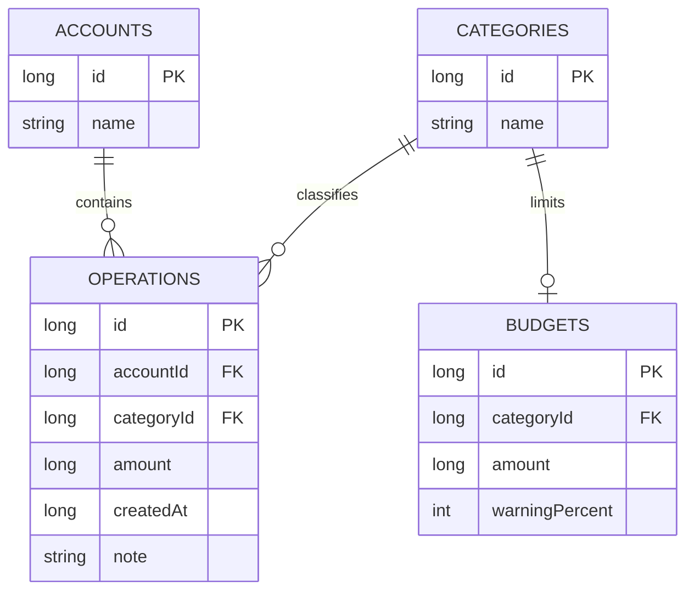

# Лабораторная работа № 5 — учёт личных финансов

Откройте `finance-lab` в Android Studio и запустите конфигурацию `app`. Для сборки: `./gradlew :app:assembleDebug :app:testDebugUnitTest`.

Денежные суммы хранятся целым числом копеек. Лимит относится к календарному месяцу, предупреждение возникает при достижении 80 %, превышение — выше 100 %. Порог хранится вместе с лимитом. При удалении счёта удаляются его операции; при удалении категории — её операции и лимит.

WorkManager планирует напоминания с приблизительным временем выполнения, которое зависит от ограничений Android. Повторяющийся платёж напоминает каждые 30 дней. Разрешение на уведомления необязательно для работы каталога.
