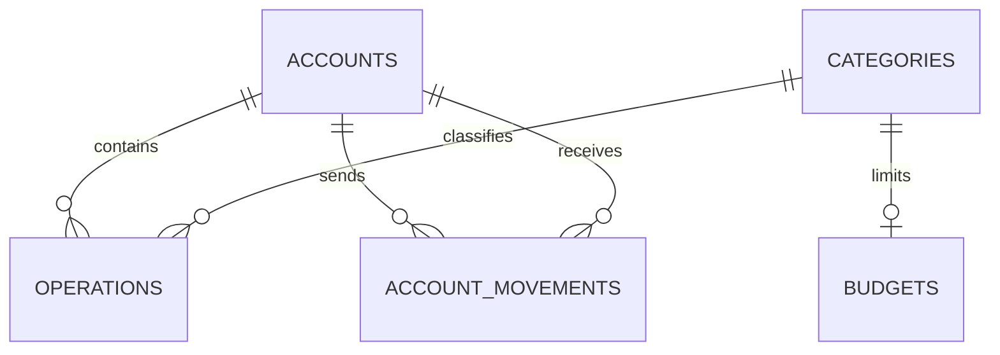

# Лабораторная работа № 5 — учёт личных финансов

Откройте папку `Lab5` в Android Studio. Сборка и тесты: `./gradlew :app:assembleDebug :app:testDebugUnitTest`.

Приложение ведёт **локальный учёт** и не подключается к банку. При создании счёта остаток равен нулю; внесите фактический остаток через «Пополнить счёт». Расходы и переводы нельзя провести сверх доступного остатка. Закрыть счёт с деньгами можно только после перевода всей суммы на другой активный счёт. Закрытые счета и их операции сохраняются. Дата окончания карты служит предупреждением и сама не перемещает деньги. Категорию с операциями удалить нельзя.

После обновления со старой версии остатки установлены в ноль: старые расходы остаются в истории, но не списываются повторно. Необходимо вручную указать фактические остатки. Денежные суммы хранятся в копейках. Лимит относится к календарному месяцу, предупреждение возникает при достижении 80 %, превышение — выше 100 %.

WorkManager выполняет напоминания приблизительно: время зависит от ограничений Android. Повторяющийся платёж напоминает каждые 30 дней. Разрешение на уведомления необязательно для работы приложения.
